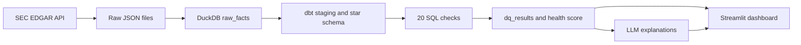

# Financial Data Quality Monitor

A data pipeline and monitoring tool for SEC EDGAR financial data. It loads reported financials for 25 large US companies into DuckDB, runs 20 SQL data quality checks, scores the data's health from 0 to 100, and uses an LLM to explain each failure in plain English. A Streamlit dashboard lets you inspect the results and inject faults to watch the monitor catch them.

**Live demo:** <https://fin-data-quality-monitor-benchaffe.streamlit.app>

## What it does
 
1. **Ingests** structured financial facts (revenue, net income, operating income, assets, liabilities, equity) from the SEC's free EDGAR company facts API.
2. **Models** them with dbt into a small star schema: `dim_company`, `dim_metric` and `fact_financials`, with one version of each fact.
3. **Checks** the data with 20 SQL checks across six quality dimensions. Each check is a standalone `.sql` file that returns the failing rows.
4. **Scores** every run from 0 to 100 using weighted dimension scores.
5. **Explains** failures using an LLM that receives only the check result and up to five sample rows, and must return JSON that passes a pydantic schema.
6. **Proves it works** by injecting known faults into a copy of the data and measuring how many the checks catch.
## Architecture
 

 
- **DuckDB** is the warehouse: fast, file-based and good at the window functions the checks use.
- **dbt** builds and tests the models and generates the lineage graph (`docs/lineage.png`).
- **Python** handles ingestion, the check runner, scoring, fault injection and the LLM explainer.
- **Streamlit** hosts the dashboard.
## Results
 
| Metric | Result |
| --- | --- |
| Companies and rows modelled | 25 companies, 11268 fact rows |
| Injected faults detected | 9 of 10 |
| Health score on clean data | 96.7 |
| Checks not passing on clean data | 1 of 20 (`stale_load`, which is correct: see "Data snapshot") |
| LLM explanations naming the right cause | 9 of 9, reviewed by hand |
 
Fault results are in `eval/fault_results.csv` and the explanation review is in `eval/explanation_review.csv`.
 
## The 20 checks
 
| Dimension | Checks |
| --- | --- |
| Completeness | `missing_filed_date`, `missing_fiscal_year`, `missing_period_start`, `company_missing_core_metric` |
| Uniqueness | `duplicate_facts` |
| Referential integrity | `orphan_facts_no_company`, `orphan_facts_no_metric` |
| Validity | `negative_assets`, `negative_revenue`, `revenue_growth_outlier`, `revenue_unit_jump`, `period_end_in_future`, `invalid_period_length` |
| Consistency | `balance_sheet_equation`, `filed_before_period_end`, `schema_drift`, `row_count_change` |
| Timeliness | `stale_company`, `missing_annual_periods`, `stale_load` |
 
The SQL techniques used include anti-joins, CTEs, window functions (`LAG`, rolling frames, `ROW_NUMBER`), conditional aggregation for pivots, set operations (`EXCEPT`) for schema drift, and date arithmetic for gap detection.
 
**Health score:** each check scores 1 if it passes and 0 otherwise. Checks are averaged within each dimension, and dimensions are combined using these weights: completeness 25, validity 20, uniqueness 15, referential integrity 15, consistency 15, timeliness 10. The weights live in a table so they can be explained and changed.
 
**Tolerances:** a check can allow a small share of rows to fail through a `-- tolerance:` header. These are used on four checks: 0.1% on `missing_period_start`, `negative_assets` and `negative_revenue`, and 2% on `invalid_period_length`.
 
## Fault injection
 
To test the monitor, scripts corrupt a copy of the warehouse and the checks are re-run. Each fault names the check that should catch it:
 
| Fault | What it does | Expected check |
| --- | --- | --- |
| duplicate_rows | Duplicates about 5% of fact rows | `duplicate_facts` |
| drop_company_revenue | Deletes one company's revenue | `company_missing_core_metric` |
| unit_error_x1000 | Multiplies a company's latest revenue by 1000 | `revenue_unit_jump`, `revenue_growth_outlier` |
| stale_company | Removes a company's last 500 days | `stale_company` |
| schema_drift | Adds an unexpected column | `schema_drift` |
| break_balance_sheet | Multiplies one company's assets by 1.5 | `balance_sheet_equation` |
| null_filed_date | Sets `filed_date` to null on about 3% of rows | `missing_filed_date` |
| null_fiscal_year | Sets `fiscal_year` to null on about 3% of rows | `missing_fiscal_year` |
| negative_assets | Flips the sign of one company's total assets | `negative_assets` |
| future_period_end | Moves the period end of about 1% of revenue rows 400 days into the future | `period_end_in_future` |
 
A fault counts as detected when an expected check fails with more failing rows than on the clean data. The dashboard's "Inject and re-run" page lets anyone try this live.
 
## What I found in the data
 
Running the monitor on real SEC data surfaced problems that shaped the pipeline:
 
- **Facts also appear in non-periodic filings.** Rows from 8-Ks and proxy statements had no fiscal year, which `missing_fiscal_year` flagged. The model now keeps only 10-K and 10-Q filings.
- **Companies change revenue tags over time.** Older filings use `SalesRevenueNet`, newer ones use `RevenueFromContractWithCustomerExcludingAssessedTax`, Goldman Sachs uses `RevenuesNetOfInterestExpense`, and Pfizer and Merck report 2014 to 2016 revenue under `SalesRevenueGoodsNet`. `missing_annual_periods` exposed the gaps, and the model now maps all of these to one `revenue` metric with an explicit priority order.
- **A tie-break bug the monitor caught.** In one Procter & Gamble filing, fiscal 2012 had two revenue tags with different values (28.4B under `Revenues` and 82.0B under `SalesRevenueNet`). My first dedupe rule broke the tie arbitrarily and kept the wrong one, which `revenue_growth_outlier` flagged. The fix was a deliberate tag priority.
- **Balance sheets mix filings.** For 502 of the 960 period-ends where assets, liabilities and equity all exist, the three values come from more than one filing, because a restatement can update one number and not the others. The balance sheet check now only tests dates where all three come from the same filing.
- **52 and 53-week fiscal calendars** produce period lengths such as 118, 167 and 251 days. The allowed period-length ranges were widened to match.
- **A few genuine one-off quirks** from 2008 period facts filed in 2011: a zero total assets figure, a negative revenue figure for a one-month transition period, and a period with no start date. These are handled with a 0.1% tolerance rather than hidden.
## Data snapshot and the one failing check
 
The deployed dashboard runs on a snapshot loaded on 23/10/26. The `stale_load` check fails because that load is now more than seven days old, which is the intended behaviour: the monitor is correctly reporting that its own data is stale. Every other check passes. The pipeline has no scheduled refresh yet (see Next steps), so the failure stays until the data is reloaded.
 
## Design decisions
 
- **One row per fact.** Facts are deduplicated to the most recent filing per company, metric and period, with tag priority as the tie-breaker, so restatements win and results are reproducible.
- **Checks return failing rows, not counts.** A runner does the counting and stores up to five sample rows, which also feed the dashboard and the LLM.
- **LLM output is constrained.** Temperature is 0, the output must pass a pydantic schema, there is one retry, only five sample rows are sent, and every call is logged with latency and token counts.
- **Faults run on copies.** The clean warehouse is never modified by the demo.
- **The public app makes no LLM calls.** Explanations are stored in the database, so visitors cannot run up API costs.
## Limitations
 
- 25 companies and seven XBRL metrics only; thresholds were tuned on this sample, so the clean score is not an independent measure of quality.
- The tolerances and tag priority list are judgement calls (documented above).
- The injected faults were written by me, so the detection rate shows the checks work for those cases, not that every real-world fault would be caught.
- LLM explanations were reviewed by hand on a small sample.
- No scheduled ingestion: data is loaded manually from local files, and the dashboard shows a static snapshot.
## Run it locally
 
```bash
git clone https://github.com/benchaffe/fin-data-quality-monitor
cd fin-data-quality-monitor
python -m venv .venv && source .venv/bin/activate
pip install -r requirements.txt
```
 
Create a `.env` file (it is git-ignored):
 
```text
SEC_USER_AGENT=Your Name your.email@example.com
LLM_API_KEY=your-key
LLM_MODEL=model-name
```
 
Then:
 
```bash
python ingest/download_edgar.py          # download company facts from EDGAR
python ingest/load_duckdb.py             # flatten and load into DuckDB
cd warehouse && dbt run --profiles-dir . && dbt test --profiles-dir . && cd ..
python quality/run_checks.py             # run the 20 checks
python -c "from quality.scoring import apply_scoring; apply_scoring('warehouse/warehouse.duckdb')"
streamlit run app/Home.py                # open the dashboard
python -m eval.run_fault_eval            # fault injection evaluation
pytest -q                                # scoring tests
```
 
The SEC asks every request to carry a descriptive `User-Agent` and to stay under about 10 requests a second; the download script does both.
 
## Repo layout
 
```text
ingest/      EDGAR download and DuckDB loader
warehouse/   dbt project (staging view, dimensions, fact table)
quality/     SQL checks, runner, scoring, fault scripts, LLM explainer
app/         Streamlit dashboard (5 pages)
eval/        Fault evaluation and explanation review outputs
docs/        Lineage graph and screenshots
tests/       Scoring tests
```
 
## Next steps
 
- Scheduled ingestion (a weekly AWS Lambda writing to S3) so the data refreshes and `stale_load` passes honestly.
- A `conflicting_revenue_tags` check that catches the Procter & Gamble class of problem directly.
- Build balance sheets from a single filing rather than mixing filings per metric.
- More companies and metrics, and check thresholds learned from the data instead of set by hand.
## Data source
 
Financial facts come from the SEC's public [EDGAR APIs](https://www.sec.gov/search-filings/edgar-application-programming-interfaces). This project is for portfolio and learning purposes and is not financial advice.